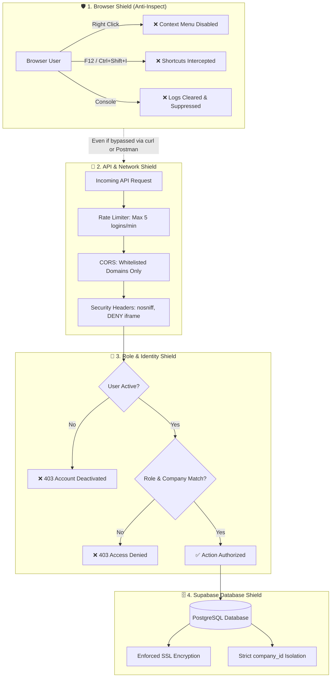
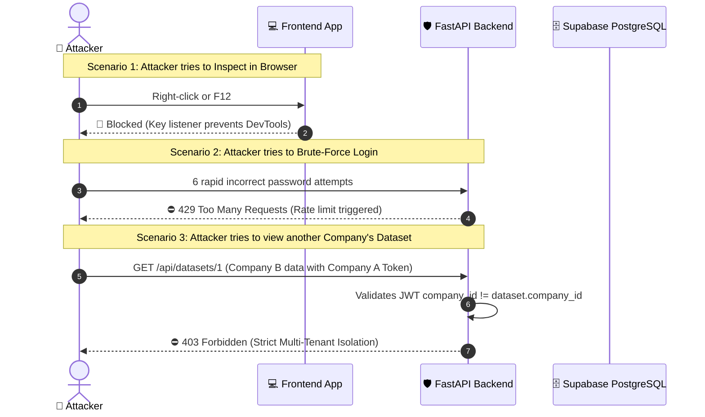

# CarbonLens AI — Visual Security & Anti-Inspection Guide

A clear, visual explanation of how CarbonLens AI protects its data and prevents unauthorized inspection and tampering.

---

## 1. The 4-Layer Defense Architecture

---

## 2. Attack vs Defense Sequence

---

## 3. Summary of Security Controls

| Protection Layer | What It Does | Threat Stopped |
| :--- | :--- | :--- |
| **Anti-Inspect & Anti-Tamper** | Disables right-click, `F12`, `Ctrl+Shift+I`, `Ctrl+U`, and strips console logs | Casual inspection, code copying, and client script tampering |
| **Login Rate Limiting** | Limits failed logins to 5 per minute per IP | Automated password guessing and credential stuffing |
| **Active User Verification** | Checks `user.is_active` on every API call | Revoked/deactivated users using old tokens |
| **Password Complexity** | Enforces minimum 8 characters, uppercase, and numbers | Weak, easily cracked user passwords |
| **CORS & HTTP Headers** | Whitelists frontend origin + anti-iframe headers | Cross-site request hijacking and clickjacking |
| **File Upload Ceiling** | Limits dataset uploads to 50MB and cleans formula prefixes | Memory exhaustion DoS and spreadsheet formula injection |
