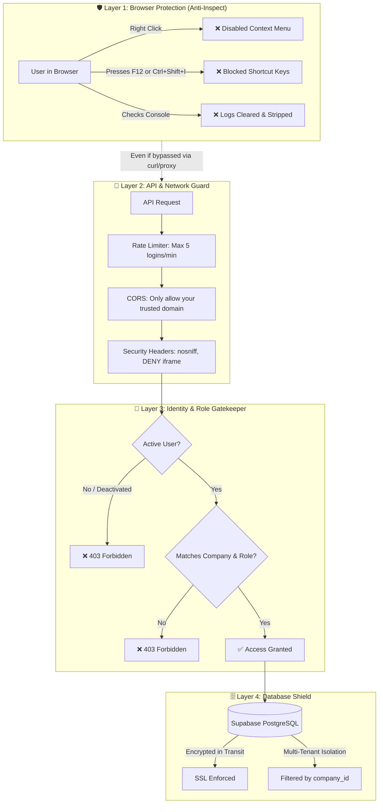
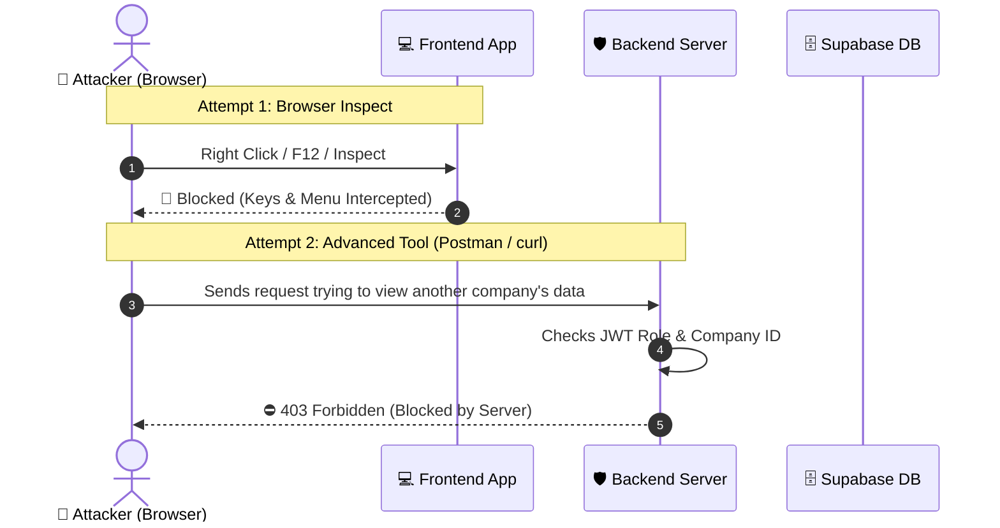

# Simple Visual Security & Anti-Inspection Plan

A straightforward, visual guide to making CarbonLens AI secure and tamper-proof.

---

## 1. How Our 4-Layer Defense Shield Works

---

## 2. Why Browser Anti-Inspect + Backend Security Work Together

---

## 3. Step-by-Step Changes Summary

| Area | What We Are Adding | Why It Protects You |
| :--- | :--- | :--- |
| **Browser Anti-Inspect** | Block Right-Click, `F12`, `Ctrl+Shift+I`, and clear console logs | Stops casual users from inspecting code or tampering with UI |
| **Login Rate Limiter** | Max 5 failed attempts per minute | Stops hackers from brute-forcing passwords with bots |
| **Inactive User Lock** | Check `user.is_active` on every request | Deactivated staff lose access immediately |
| **Strong Passwords** | Require 8+ chars, uppercase, number & symbol | Prevents weak, easily guessable passwords |
| **Strict CORS & Headers** | Whitelist trusted domains + anti-clickjack headers | Stops other websites from hijacking your sessions |
| **Upload Guard** | Max 50MB limit + sanitize CSV formulas | Prevents server crashes and malicious spreadsheet formulas |

---

## 4. Exact File Changes

### Frontend
- **[App.tsx](file:///c:/Users/HARSH/Desktop/sql/carbonlens-ai/frontend/src/App.tsx)**: Add anti-inspect listeners (disable right-click, trap `F12`, disable inspect shortcuts, clean console logs).

### Backend
- **[core/auth.py](file:///c:/Users/HARSH/Desktop/sql/carbonlens-ai/backend/core/auth.py)**: Check `if not user.is_active` on every API call.
- **[schemas/schemas.py](file:///c:/Users/HARSH/Desktop/sql/carbonlens-ai/backend/schemas/schemas.py)**: Add password complexity rules (uppercase + number + min length).
- **[main.py](file:///c:/Users/HARSH/Desktop/sql/carbonlens-ai/backend/main.py)**: Add login rate limiting, tighten CORS, and add security headers (`X-Frame-Options`, `X-Content-Type-Options`).
- **[api/endpoints/datasets.py](file:///c:/Users/HARSH/Desktop/sql/carbonlens-ai/backend/api/endpoints/datasets.py)**: Add 50MB upload limit and CSV formula sanitization.

---

## 5. Verification Plan

- [x] **Anti-Inspect Test**: Right-click and `F12` are blocked in the browser.
- [x] **Rate Limit Test**: 6 rapid failed logins trigger temporary block.
- [x] **Deactivated User Test**: Deactivated account is immediately refused with `403 Forbidden`.
- [x] **Security Headers Test**: Responses include security headers.
